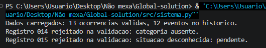
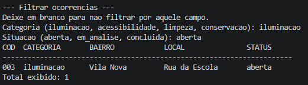
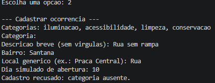
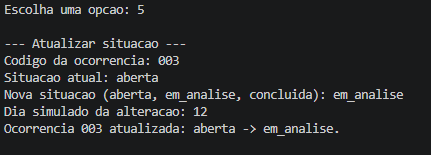
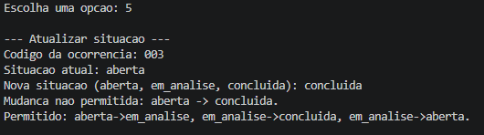
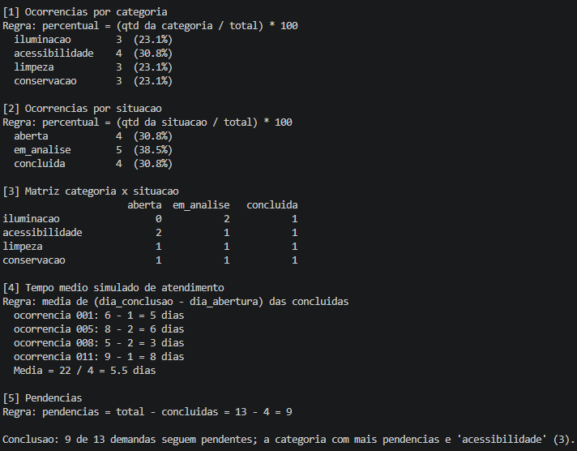

# 1º Semestre

Global Solution 2026 – CitizenTech | FIAP

## 1. Equipe

**|   Grupo 41   |**
**| Gabriel Bela dos Santos | RM: 575188 |**

## 2. Problema, bairros e público

Problemas de infraestrutura e conservação (iluminação, acessibilidade, limpeza e conservação de espaços coletivos) afetam a qualidade de vida. Muitas vezes os registros ficam dispersos, as prioridades não ficam claras e os moradores não conseguem acompanhar as solicitações.

Este protótipo, executado no terminal, cadastra ocorrências, consulta o andamento, atualiza a situação e calcula indicadores simples.

- **Bairros simulados:** Jardim Esperanca, Vila Nova e Centro.
- **Público:** moradores, pessoas com mobilidade reduzida, idosos e equipes de manutenção que precisam organizar as demandas.
- **Dados:** fictícios, sem informações pessoais.

## 3. Dados e formato dos arquivos

Os dados não estão embutidos no código. São lidos de dois CSV simples (separados por vírgula, UTF-8), mas ambos se encontram no Github.

**`data/dados.csv`** – ocorrências

| Campo | Obrigatório | Descrição |

| id | sim | Código único com 3 dígitos (ex.: 001) |
| categoria | sim | iluminacao, acessibilidade, limpeza ou conservacao |
| descricao | sim | Descrição breve |
| bairro | sim | Bairro fictício |
| local | sim | Local genérico (ex.: Praca Central) |
| dia_abertura | sim | Dia simulado de abertura (inteiro) |
| status | sim | aberta, em_analise ou concluida |
| dia_conclusao | só se concluida | Dia simulado de conclusão (inteiro) |

**`data/historico.csv`** – eventos de mudança de situação (`id,dia,de,para`), 12 eventos.

**Situações:**
- `aberta`: registrada, ainda não examinada pela equipe.
- `em_analise`: a equipe está avaliando ou executando o serviço.
- `concluida`: problema resolvido. Exige dia de conclusão.

**Registros inconsistentes (de propósito, para testar a validação):**
- **014:** categoria ausente.
- **015:** situação desconhecida ("pendente").

Ambos são rejeitados na carga e listados na opção 10 do menu.

## 4. Estruturas de dados utilizadas

| Estrutura | Onde é usada | Por quê |

| Lista (`ocorrencias`) | Conjunto de ocorrências válidas | Permite percorrer, listar e filtrar em ordem |
| Dicionário (`indice`) | `id -> ocorrência` | Acesso direto pelo código, sem percorrer a lista |
| Fila (`fila_analise`, `deque`) | Demandas abertas ainda não examinadas | Atende por ordem de registro (primeiro a entrar, primeiro a sair) |
| Pilha (`pilha_eventos`) | Eventos de mudança de situação | O evento mais recente fica no topo e é consultado primeiro |
| Hierarquia (dicionário aninhado) | `bairro -> categoria -> [ids]` | Organiza as demandas por região e tipo |
| Matriz (lista de listas) | Categoria × situação | Sintetiza quantidades e base dos indicadores |

## 5. Regras lógicas

O sistema usa `if`/`elif`/`else` e os operadores `and`, `or` e `not` em validações e filtros:

- **`validar_registro`:** rejeita categoria ausente ou desconhecida, campos vazios, situação desconhecida, dia inválido e inconsistências no dia de conclusão.
- **`transicao_valida`:** controla quais mudanças de situação são permitidas.
- **`filtrar`:** combina filtros opcionais de categoria e situação.
- **`atualizar`:** impede situação desconhecida e transição inválida.

**Expressão booleana documentada** (`transicao_valida`):

```python
permitida = (atual == "aberta" and novo == "em_analise") or (
    atual == "em_analise" and (novo == "concluida" or novo == "aberta")
)
return permitida and not (atual == "concluida")
```

**Por que produz cada resultado:**
- `aberta -> em_analise` é permitida: o primeiro bloco do `or` é verdadeiro.
- `em_analise -> concluida` e `em_analise -> aberta` são permitidas: o segundo bloco é verdadeiro.
- `aberta -> concluida` é recusada, pois nenhum bloco é verdadeiro. A ocorrência precisa ser analisada antes.
- Qualquer mudança a partir de `concluida` é recusada. Mesmo que `permitida` fosse verdadeira, o `not (atual == "concluida")` a bloqueia.

## 6. Indicadores

| Indicador | Fórmula |

| Total por categoria | contagem de ocorrências da categoria |
| Percentual por categoria | (qtd da categoria / total) × 100 |
| Total por situação | contagem de ocorrências da situação |
| Percentual por situação | (qtd da situação / total) × 100 |
| Matriz categoria × situação | lista de listas com as contagens |
| Tempo médio simulado | média de (dia_conclusao − dia_abertura) das concluídas |
| Pendências | total − concluídas |

**Resultado com os dados fornecidos** (13 ocorrências válidas):
- Por categoria: 3 iluminação, 4 acessibilidade, 3 limpeza e 3 conservação.
- Por situação: 5 abertas, 4 em análise e 4 concluídas.
- Tempo médio: (5 + 6 + 3 + 8) / 4 = 5,5 dias.
- Pendências: 13 − 4 = 9.

**Interpretação:** [escreva 2 ou 3 frases com suas conclusões. Exemplo: "Mais de 2/3 das demandas continuam pendentes, e acessibilidade concentra mais ocorrências, o que sugere atenção prioritária à mobilidade."]

## 7. Como executar

Requisito: Python 3 e não são necessárias bibliotecas externas.

```bash
python src/sistema.py
```

No Windows, se `python` não funcionar, use `py src/sistema.py`. Também funciona pelo botão ▶ (`executar`) do VS Code. O programa encontra os CSV pelo caminho do próprio `sistema.py`.

**Menu:**

| Opção | Função |
|---|---|
| 1 | Listar ocorrências |
| 2 | Cadastrar ocorrência |
| 3 | Buscar por código (com histórico) |
| 4 | Filtrar por categoria e/ou situação |
| 5 | Atualizar situação |
| 6 | Ver fila de demandas não examinadas |
| 7 | Ver últimos eventos |
| 8 | Ver hierarquia bairro > categoria |
| 9 | Ver indicadores |
| 10| Ver registros rejeitados |
| 0 | Sair |

As alterações feitas no menu valem só durante a execução. Os CSV não são regravados.

## 8. Exemplos de uso

1. **Carga:** mensagem de abertura com as rejeições dos registros 014 e 015.


2. **Filtro:** opção 4 com `iluminacao` e `aberta`.


3. **Cadastro:** opção 2 com categoria vazia, que é recusada.


4. **Atualização:** opção 5 em `003` para `em_analise`, que é aceita e registrada na pilha.


5. **Recusa:** opção 5 tentando ir de `aberta` direto para `concluida`.


6. **Indicadores:** opção 9, com fórmulas e resultados.


## 9. Acessibilidade, inclusão e privacidade

- **Privacidade:** dados fictícios, sem nome, telefone, endereço exato ou qualquer informação pessoal. Os locais são genéricos.
- **Acessibilidade:** a interface é textual, com mensagens curtas e objetivas, sem depender de cor ou imagem. Funciona com leitores de tela de terminal.
- **Inclusão:** a categoria "acessibilidade" tem destaque, e o público inclui pessoas com mobilidade reduzida.
- **Clareza:** os erros dizem o que aconteceu, por exemplo "Ocorrencia 099 nao encontrada" ou o motivo de cada rejeição.
- **Limitação:** o sistema não faz integração direta com orgão públicos.

## 10. Vídeo

**Link do vídeo do youtube:** https://youtu.be/Pyi13OCKyS0?is=1wIMVPtj8f6bzq60

## 11. Conclusões, limitações e aprendizados

- **Limitações:** os dados não são salvos no CSV, o campo de texto não aceita vírgulas e o sistema trata um bairro por vez na interface.
- **Aprendizados:** Este projeto teve uma função muito importante para enterder como podemos aplicar, o conhecimento adiquirido no curso, na vida real e ajudar pessoas. Me fez ver o lado da prgramação d euma forma diferente. Saio deste trabalho com mais vontade de aprender, para assim conseguir colocar em prática soluções para o cotidiano;

## 12. Uso de IA

- A IA foi utilizado na construção da ideia do projeto.
- Houve também a utilização para gerar dados fictícios para o sistema.
- Diante disso, foi refletido sobre as propostas apresentadas e escolhida uma que mais se encaixava no tema. Os dados gerados foram conferidos e testados antes da entrega final.